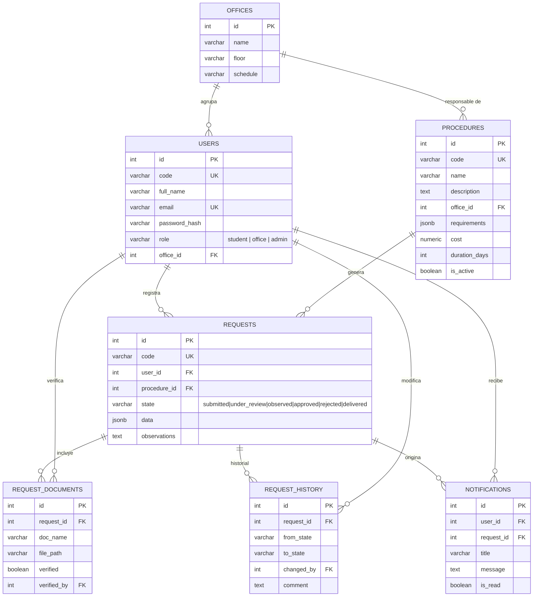
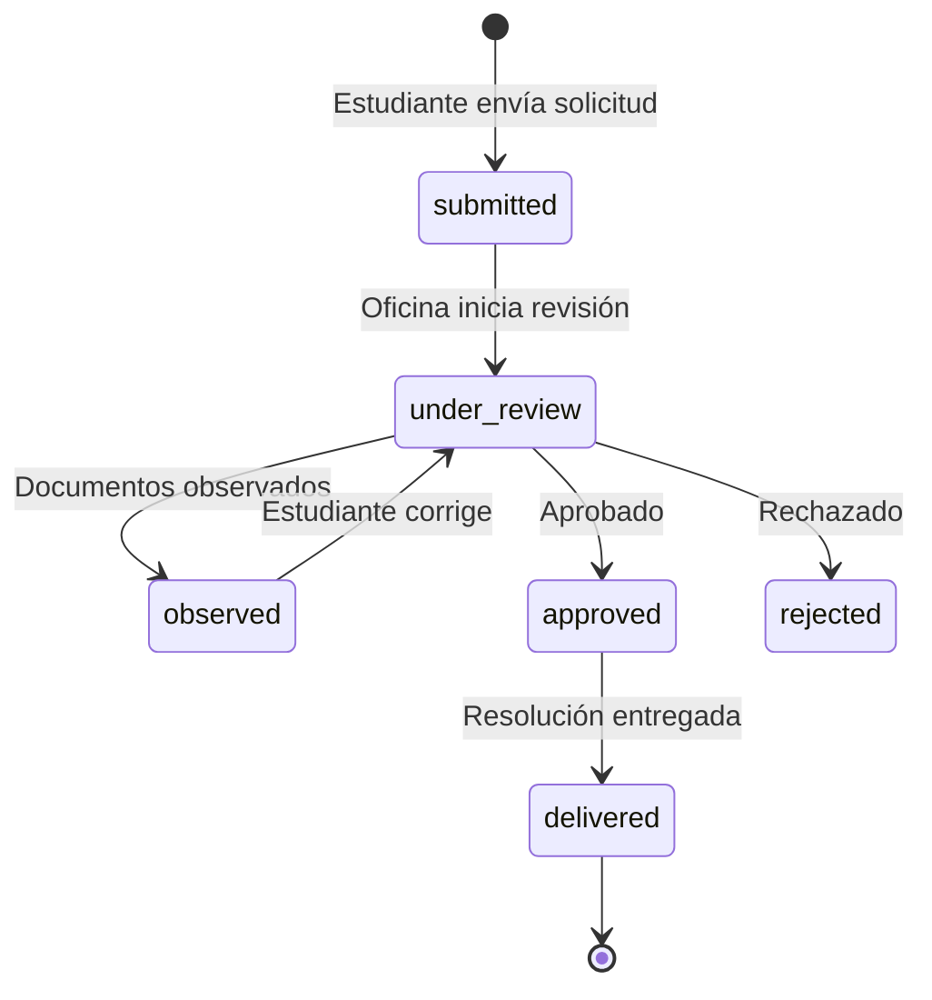

# Modelo Entidad-Relación — Plataforma TUPA UNSAAC

## Estados de un trámite

## Relaciones principales

| Relación | Cardinalidad | Descripción |
|----------|--------------|-------------|
| offices — users | 1 : N | Cada usuario (oficina) pertenece a una oficina |
| offices — procedures | 1 : N | Cada procedimiento tiene una oficina responsable |
| users — requests | 1 : N | Un estudiante registra muchas solicitudes |
| procedures — requests | 1 : N | Un procedimiento genera muchas solicitudes |
| requests — request_documents | 1 : N | Cada solicitud adjunta varios documentos |
| requests — request_history | 1 : N | Cada solicitud registra sus cambios de estado |
| users — notifications | 1 : N | Cada usuario recibe notificaciones |
